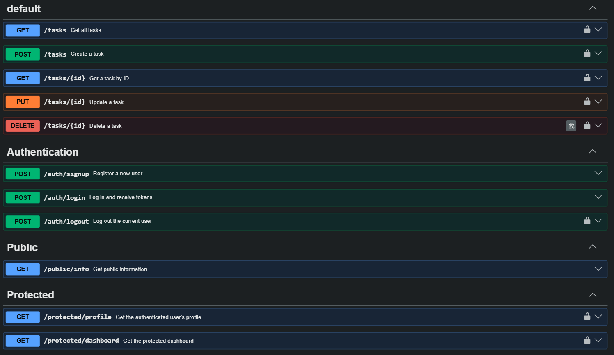
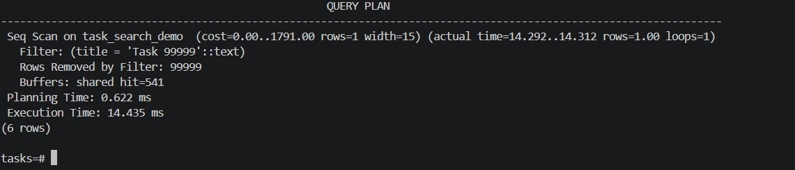
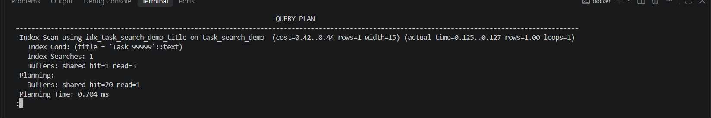

# CRUD REST API

A CRUD REST API built with **Node.js, Express.js, and PostgreSQL**, containerized using **Docker and Docker Compose**.

The project started as an in-memory CRUD API, was upgraded to SQLite, and now uses PostgreSQL for persistent storage. The API endpoints remain consistent across the database migration.

## 🚀 Features

- RESTful CRUD API
- PostgreSQL database with `pg`
- Persistent task storage
- Automatic database creation
- Automatic `tasks` table creation
- Three sample tasks inserted when the table is empty
- Input validation
- Proper HTTP status codes
- Layered project structure
- Swagger / OpenAPI documentation
- Environment variable configuration
- SQL queries for database operations

---

## 🛠️ Tech Stack

- **Node.js**
- **Express.js**
- **PostgreSQL**
- **`pg` PostgreSQL client**
- **Docker**
- **Docker Compose**
- **Swagger UI**

---

## 📁 Project Structure

```text
crud-api/
│
├── controllers/
│   └── taskController.js
│
├── models/
│   └── taskModel.js
│
├── routes/
│   └── taskRoutes.js
│
├── screenshots/
│   └── database.png
│
├── database.js
├── Dockerfile
├── .dockerignore
├── compose.yaml
├── .env.example
├── server.js
├── .env
├── .gitignore
├── package.json
├── package-lock.json
└── README.md
```

## 🗄️ Database

The application uses PostgreSQL for persistent task storage. The database and `tasks` table are initialized automatically when the application starts. SQLite was used in an earlier version of the project.

Three sample tasks are automatically inserted only when the table is empty.

## 🔌 API Endpoints

| Method | Endpoint | Description |
|---|---|---|
| GET | `/tasks` | Get all tasks |
| GET | `/tasks/:id` | Get a task by ID |
| POST | `/tasks` | Create a new task |
| PUT | `/tasks/:id` | Update a task |
| DELETE | `/tasks/:id` | Delete a task |


## Week 4 — Supabase Authentication

The API uses Supabase Auth for user registration, login, and session management. Protected routes require a valid Supabase access token in the Authorization header.

### Authentication Endpoints

| Method | Endpoint | Authentication | Success |
|---|---|---|---|
| POST | `/auth/signup` | Public | 201 Created |
| POST | `/auth/login` | Public | 200 OK |
| POST | `/auth/logout` | Bearer token | 204 No Content |
| GET | `/public/info` | Public | 200 OK |
| GET | `/protected/profile` | Bearer token | 200 OK |
| GET | `/protected/dashboard` | Bearer token | 200 OK |


### Request and Response Reference

#### POST `/auth/signup`

Register a new user.

Request body:

```json
{
  "email": "your-test-email@example.com",
  "password": "your-test-password"
}
```

Responses:
- `201 Created` — User registration succeeded.
- `400 Bad Request` — Missing fields or signup failed.

#### POST `/auth/login`

Authenticate an existing user with their email and password.

Responses:
- `200 OK` — Returns `access_token` and `refresh_token`.
- `400 Bad Request` — Email or password is missing.
- `401 Unauthorized` — Invalid login credentials.

#### POST `/auth/logout`

Requires `Authorization: Bearer YOUR_ACCESS_TOKEN`.

Responses:
- `204 No Content` — Logout succeeded.
- `401 Unauthorized` — Missing token or logout failed.

#### GET `/public/info`

No authentication required.

Returns:

```json
{
  "message": "Welcome stranger! This info is public."
}
```

#### GET `/protected/profile`

Requires a valid Bearer access token. Returns the authenticated user's ID, email, and account creation timestamp.

#### GET `/protected/dashboard`

Requires a valid Bearer access token. Returns a welcome message and the authenticated user's ID and email.

Protected endpoints reject missing or invalid access tokens with `401 Unauthorized`.


### Register a user

Send a JSON request to `POST /auth/signup`:

```json
{
  "email": "your-test-email@example.com",
  "password": "your-test-password"
}
```

### Log in

Send the same credentials to `POST /auth/login`. A successful response contains `access_token` and `refresh_token`.

### Access a protected endpoint

Include the access token in the request header:

```http
Authorization: Bearer YOUR_ACCESS_TOKEN
```

Requests without a valid token are rejected with HTTP 401.

### Public endpoint

`GET /public/info` is accessible without authentication.

### Swagger UI

Start the application and visit:

http://localhost:3000/docs

The Swagger UI documents the task CRUD endpoints, authentication routes, public endpoint, and protected endpoints.

## 📖 Swagger Documentation
The API includes interactive Swagger/OpenAPI documentation.
After starting the server, open:
http://localhost:3000/docs

Swagger allows you to test all CRUD endpoints directly from the browser.

### Week 4 — Authentication API Documentation

The screenshot below shows the task CRUD, authentication, public, and protected endpoints documented in Swagger UI.



## ⚙️ Environment Configuration
The application uses environment variables through dotenv.
Create a .env file in the project root:
PORT=3000

The server uses the configured port and falls back to port 3000 if no port is provided.
const port = process.env.PORT || 3000;

The .env file is excluded from Git using .gitignore.
## Getting Started

### Prerequisites

- Node.js and npm
- Docker Desktop with Docker Compose
- A Supabase project

### 1. Clone the repository

```bash
git clone https://github.com/Paras045/crud-api.git
cd crud-api
```

### 2. Configure environment variables

Copy `.env.example` to `.env`:

```powershell
Copy-Item .env.example .env
```

Update `.env` with your own Supabase project URL and publishable key.

Never commit your real `.env` file or share its credentials.

### 3. Start the application

```bash
docker compose up --build -d
```

### 4. Verify the services

```bash
docker compose ps
docker compose logs api
```

The API should be available at `http://localhost:3000`.

### 5. Open Swagger UI

Visit `http://localhost:3000/docs` to explore and test the API.
## 🧪 Testing the API
Get all tasks
GET /tasks

Example:
[
  {
    "id": 10,
    "title": "TASK 1",
    "done": false
  },
  {
    "id": 11,
    "title": "TASK 2",
    "done": false
  },
  {
    "id": 12,
    "title": "TASK 3",
    "done": false
  }
]

Get a task by ID
GET /tasks/10

Example response:
{
  "id": 10,
  "title": "TASK 1",
  "done": false
}

If the task does not exist:
404

{
  "error": "Task 10 not found"
}

Create a task
POST /tasks

Request body:
{
  "title": "Learn PostgreSQL"
}

Successful response:
201 Created

Example:
{
  "id": 13,
  "title": "Learn PostgreSQL",
  "done": false
}

Update a task
PUT /tasks/13

Request body:
{
  "title": "Learn PostgreSQL",
  "done": true
}

Successful response:
200 OK

Example:
{
  "id": 13,
  "title": "Learn PostgreSQL",
  "done": true
}

The API accepts `true` or `false` for the `done` field, which PostgreSQL stores as a Boolean value.
Delete a task
DELETE /tasks/13

Successful response:
204 No Content

The response contains no JSON body.
✅ Validation
The API validates incoming requests.
Missing or invalid title
{
  "title": 123
}

Returns:
400 Bad Request

{
  "error": "Title must be a non-empty string"
}

Invalid done value
{
  "done": "true"
}

Returns:
400 Bad Request

{
  "error": "Done must be true or false"
}

Missing task
Requests for a task that does not exist return:
404 Not Found

## PostgreSQL Database

The application uses PostgreSQL to store task records persistently.

The `tasks` table contains:

| Column | Type | Description |
|---|---|---|
| `id` | SERIAL PRIMARY KEY | Unique task identifier |
| `title` | TEXT NOT NULL | Task title |
| `done` | BOOLEAN | Task completion status |

The database and table are initialized automatically when the API starts. Three example tasks are inserted only when the table is empty.

## Database Queries

The PostgreSQL database can be accessed through the Docker Compose database service.

Open the PostgreSQL shell:

```bash
docker compose exec db psql -U postgres -d tasks
```

List all tasks:

```sql
SELECT * FROM tasks ORDER BY id;
```

Show completed tasks:

```sql
SELECT * FROM tasks WHERE done = TRUE;
```

Count all tasks:

```sql
SELECT COUNT(*) FROM tasks;
```

Mark every task as completed:

```sql
UPDATE tasks SET done = TRUE;
```

Delete all completed tasks:

```sql
DELETE FROM tasks WHERE done = TRUE;
```

Exit the PostgreSQL shell:

```text
\q
```

## Data Persistence

The application originally stored tasks in an in-memory JavaScript array. The earlier database version used SQLite. The current version uses PostgreSQL running in Docker.

The current architecture is:

Client  
↓  
Express API  
↓  
Task Controllers  
↓  
Task Models  
↓  
PostgreSQL Database

Docker Compose runs the API and PostgreSQL as separate services. A named Docker volume, `taskdata`, stores the PostgreSQL data separately from the database container.

The data remains available after the Compose containers are stopped and started again, provided the named volume is preserved.

To stop the services without deleting the database volume:

```bash
docker compose down
```

Start them again:

```bash
docker compose up -d
```

Verify the task records:

```bash
Invoke-RestMethod -Uri http://localhost:3000/tasks
```

## Docker Setup

### Prerequisites

- Docker Desktop
- Docker Compose

### Run the application

Build the API image and start both services:

```bash
docker compose up --build -d
```

Check the service status:

```bash
docker compose ps
```

View API logs:

```bash
docker compose logs api
```

View database logs:

```bash
docker compose logs db
```

The API is available at:

`http://localhost:3000`

The tasks endpoint is:

`http://localhost:3000/tasks`

Stop the application:

```bash
docker compose down
```

The database volume is retained when using this command without the `-v` option.

## Project Architecture

The project follows a layered architecture:

- **Routes:** Define the API endpoints and HTTP methods.
- **Controllers:** Validate incoming requests and prepare responses.
- **Models:** Execute PostgreSQL queries for task operations.
- **Database module:** Creates the PostgreSQL connection pool and initializes the table.
- **Docker Compose:** Runs the API and database services together.
- **Persistent volume:** Stores database data across container restarts.

## HTTP Status Codes

| Status Code | Meaning |
|---|---|
| 200 | Successful request |
| 201 | Resource created |
| 204 | Resource deleted successfully |
| 400 | Invalid request |
| 404 | Resource not found |

## Assignment Requirements — W3 · A3

- [x] API exposes the existing CRUD endpoints.
- [x] PostgreSQL is used as the database.
- [x] Database and table initialization are handled by the application.
- [x] Three example tasks are inserted only when the table is empty.
- [x] CRUD operations use PostgreSQL queries.
- [x] Unknown task IDs return 404 responses.
- [x] API and PostgreSQL run as separate Docker Compose services.
- [x] API connects to PostgreSQL through the Compose service hostname.
- [x] PostgreSQL uses a named persistent Docker volume.
- [x] API and database can be started with one Compose command.
- [x] Task records remain available after stopping and restarting the Compose stack.

## Environment Configuration

Create a local `.env` file based on `.env.example` when running the API directly on your computer.

The `.env` file should not be committed to Git. Docker Compose supplies the database connection string for the containerized API.

## Technology Stack

- Node.js
- Express.js
- PostgreSQL
- `pg` PostgreSQL client
- Docker
- Docker Compose
- Swagger UI

## Optional Stretch Goals

### Redis Integration

Redis runs as a separate service in Docker Compose alongside the Node.js API and PostgreSQL database.

The application connects to Redis using the `redis` Node.js client. During startup, it sends a `PING` command and confirms connectivity when Redis responds with `PONG`.

Redis is configured using the `REDIS_URL` environment variable. Inside Docker Compose, the service hostname is `redis`.

To check service health:

```bash
docker compose ps
```

To view the API startup logs:

```bash
docker compose logs api
```

### PostgreSQL Index Experiment

A separate table, `task_search_demo`, was created with 100,000 rows to compare query plans without changing the application's actual `tasks` table.

The query used was:

```sql
EXPLAIN ANALYZE
SELECT *
FROM task_search_demo
WHERE title = 'Task 99999';
```

An index was created on the `title` column:

```sql
CREATE INDEX idx_task_search_demo_title
ON task_search_demo (title);

ANALYZE task_search_demo;
```

The original query plan, before the index was created, used a sequential scan and reported an execution time of **10.439 ms**.

After creating the index, PostgreSQL used `idx_task_search_demo_title` and reported an execution time of approximately **0.127 ms** in the recorded run.

A later sequential-scan run, with index scans disabled for that session, reported **14.435 ms**. This was a recreated comparison, not the original pre-index measurement.

Query timings can vary between runs because of caching and system conditions. The main observation is that PostgreSQL selected an index scan for the indexed lookup.

The experiment used a separate test table to preserve the application's task records.

#### Query Plan Evidence

**Before — Sequential Scan**

Recreated sequential-scan run (14.435 ms); this is not the original 10.439 ms baseline.



**After — Index Scan**


